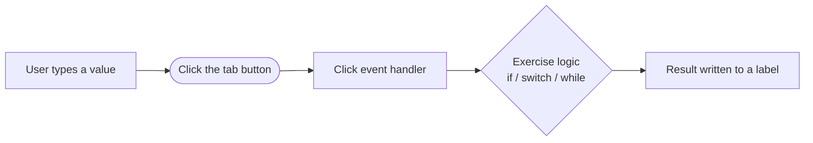

<div align="center">

# CSharp-Basic-Exercises

**A Windows Forms application that solves six introductory programming exercises, organized in tabs.**


</div>

---

## Table of Contents

- [About](#about)
- [At a Glance](#at-a-glance)
- [Exercises](#exercises)
- [Concepts Applied](#concepts-applied)
- [Program Flow](#program-flow)
- [How to Run](#how-to-run)
- [Example Interaction](#example-interaction)
- [Project Structure](#project-structure)
- [Requirements](#requirements)
- [Tech Stack](#tech-stack)

---

## About

This project was developed for the **Programming 3** course of my **Systems Engineering** degree. It contains a single form with a `TabControl` of six tabs, labeled *CASE #1* to *CASE #6*. Each tab solves one exercise: the input is read from text boxes, processed when the user clicks a button, and the result is written to a label.

The goal of the project was to practice the building blocks of programming logic: conditionals, `switch` statements, loops, arithmetic operators and string handling.

> [!NOTE]
> The application's interface text is in Spanish. The UI texts and results in this document are shown translated into English.

---

## At a Glance

| | |
|---|---|
| **Type** | Windows Forms desktop application |
| **Target framework** | .NET 6 (`net6.0-windows`) |
| **Main class** | `Form1` |
| **Difficulty** | ★☆☆ |
| **Key concepts** | `if`/`else if`, `switch`, `while` loops, modulo, string handling |

---

## Exercises

| Case | Exercise | Implementation | Result |
|:---:|---|---|---|
| 1 | Phone number type | `TipoTelefonoMetodo(string)` evaluates the input `Length` with `if`/`else if` | 7 characters: landline or local; 9: mobile; 10 or more: international; any other length asks for a valid number |
| 2 | Vowel or consonant | `TipoCaracter(string)` uses `switch` on the lower-cased input | `a`, `e`, `i`, `o`, `u` are reported as vowels; an empty input or a space asks for a character; any other value is reported as a consonant |
| 3 | Sum from 100 to 200 | `while` loop accumulating every number from 100 to 200 inclusive | Displays the total: `15150` |
| 4 | Countdown from 10 to 1 | Decreasing `while` loop with string concatenation and `TrimEnd` | `10, 9, 8, 7, 6, 5, 4, 3, 2, 1` |
| 5 | Even numbers in a range | Two inputs, `Math.Min` / `Math.Max`, a `while` loop and `% 2 == 0` | Lists every even number between the two values, in either input order |
| 6 | Grade evaluation | `if`/`else if` with a 0–100 range check | Up to 60: UNACCEPTABLE; up to 80: ACCEPTABLE; above 80: MERITORIOUS |

---

## Concepts Applied

- **Event-driven programming:** each tab has a button whose `Click` handler runs the exercise.
- **Methods with return values:** `TipoTelefonoMetodo` and `TipoCaracter` return the message to display as a `string`.
- **Conditionals:** `if` / `else if` chains to classify lengths, ranges and grades.
- **`switch` statements:** grouped `case` labels to detect vowels.
- **Loops:** `while` loops for accumulation, countdowns and range iteration.
- **Arithmetic and math helpers:** the modulo operator (`%`), `Math.Min` and `Math.Max`.
- **String handling:** concatenation, `ToLower`, `Length` and `TrimEnd`.
- **Type conversion:** `Convert.ToInt32` to turn text input into integers.

---

## Program Flow

Every tab follows the same pattern:



---

## How to Run

**Option 1: .NET CLI**

```bash
cd CSharp-Basic-Exercises
dotnet run --project Hoja1_Progra3A_2304002037
```

**Option 2: Visual Studio**

Open `Hoja1_Progra3A_2304002037.sln` in Visual Studio 2022 and press <kbd>F5</kbd>.

> [!TIP]
> This project targets .NET 6. If only a newer .NET runtime is installed, install the .NET 6 Desktop Runtime or run with `DOTNET_ROLL_FORWARD=Major`.

---

## Example Interaction

<details>
<summary>Show example inputs and results</summary>

```text
CASE #1 - Phone number type
  Input:  55512345           -> (8 characters) Enter a valid number or check the digits.
  Input:  5551234            -> Your number is a landline or local number.
  Input:  555123456          -> Your number is a mobile number.
  Input:  50255512345        -> Your number is an international number.

CASE #2 - Vowel or consonant
  Input:  E                  -> The entered character is: a vowel.
  Input:  b                  -> The entered character is: a consonant.

CASE #3 - Sum from 100 to 200
  Result: The sum of the numbers from 100 to 200 is: 15150

CASE #4 - Countdown from 10 to 1
  Result: 10, 9, 8, 7, 6, 5, 4, 3, 2, 1

CASE #5 - Even numbers in a range
  Input:  10 and 1           -> The even numbers are: 2, 4, 6, 8, 10

CASE #6 - Grade evaluation
  Input:  55                 -> The score is: UNACCEPTABLE
  Input:  75                 -> The score is: ACCEPTABLE
  Input:  95                 -> The score is: MERITORIOUS
  Input:  120                -> Enter a grade from 0 to 100.
```

</details>

---

## Project Structure

```text
CSharp-Basic-Exercises/
├── Hoja1_Progra3A_2304002037.sln         # Visual Studio solution
└── Hoja1_Progra3A_2304002037/
    ├── Hoja1_Progra3A_2304002037.csproj  # Project file (.NET 6, Windows Forms)
    ├── Program.cs                        # Application entry point
    ├── Form1.cs                          # Logic of the six exercises
    ├── Form1.Designer.cs                 # Generated UI layout (TabControl and controls)
    └── Form1.resx                        # Form resources
```

---

## Requirements

- Windows
- [.NET 6 SDK](https://dotnet.microsoft.com/download/dotnet/6.0) or later, **or** Visual Studio 2022 with the *.NET desktop development* workload

Clone the repository:

```bash
git clone https://github.com/XanderiukS/CSharp-Fundamentals-University.git
```

---

## Tech Stack

| Category | Technology |
|---|---|
| Language | C# |
| Framework | .NET 6 |
| UI | Windows Forms |
| IDE | Visual Studio 2022 |
| Version control | Git and GitHub |

---

<div align="center">

Part of [C# Fundamentals – University Projects](../README.md)

**Alexander Oliva** · [GitHub](https://github.com/XanderiukS) · [LinkedIn](https://www.linkedin.com/in/alexander-oliva-estrada)

</div>
