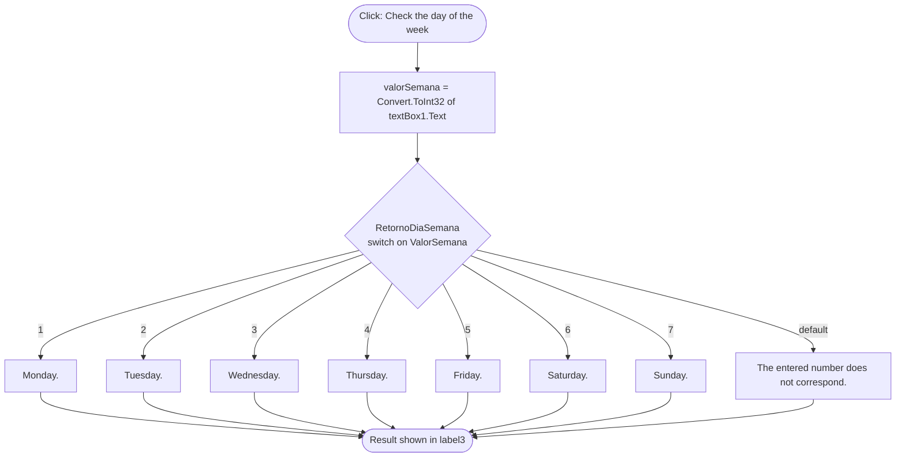

<div align="center">

# CSharp-Day-Of-Week-Evaluator

**A Windows Forms application that converts a number from 1 to 7 into the corresponding day of the week.**


</div>

---

## Table of Contents

- [About](#about)
- [At a Glance](#at-a-glance)
- [Concepts Applied](#concepts-applied)
- [Decision Logic](#decision-logic)
- [How to Run](#how-to-run)
- [Example Interaction](#example-interaction)
- [Project Structure](#project-structure)
- [Requirements](#requirements)
- [Tech Stack](#tech-stack)

---

## About

This project was developed for the **Programming 3** course of my **Systems Engineering** degree as a review of functions. The user enters a number from 1 to 7 and clicks a button; the application then displays the name of the corresponding day of the week.

The work is done by `RetornoDiaSemana(int)`, a method that receives the number and returns the day name as a `string` using a `switch` statement.

> [!NOTE]
> The application's interface text is in Spanish. The UI texts and results in this document are shown translated into English.

---

## At a Glance

| | |
|---|---|
| **Type** | Windows Forms desktop application |
| **Target framework** | .NET 6 (`net6.0-windows`) |
| **Main class** | `Form1` |
| **Key method** | `RetornoDiaSemana(int ValorSemana)` |
| **Difficulty** | ★☆☆ |
| **Key concepts** | Methods with return values, `switch` with `default`, type conversion |

---

## Concepts Applied

- **Methods with parameters and return values:** `RetornoDiaSemana` receives an `int` and returns a `string`.
- **`switch` statement:** seven `case` labels, one per day, plus a `default` branch for any other number.
- **Type conversion:** `Convert.ToInt32` to turn the text box input into an integer.
- **Event-driven programming:** the logic runs inside the button's `Click` handler.
- **Separation of logic and UI:** the event handler only reads the input and shows the result; the decision is delegated to the method.

---

## Decision Logic



---

## How to Run

**Option 1: .NET CLI**

```bash
cd CSharp-Day-Of-Week-Evaluator
dotnet run
```

**Option 2: Visual Studio**

Open `RepasoFunciones_Clase5.sln` in Visual Studio 2022 and press <kbd>F5</kbd>.

> [!TIP]
> This project targets .NET 6. If only a newer .NET runtime is installed, install the .NET 6 Desktop Runtime or run with `DOTNET_ROLL_FORWARD=Major`.

---

## Example Interaction

<details>
<summary>Show example inputs and results</summary>

```text
Enter a number from 1 to 7:  1   ->  Result: Monday.
Enter a number from 1 to 7:  3   ->  Result: Wednesday.
Enter a number from 1 to 7:  7   ->  Result: Sunday.
Enter a number from 1 to 7:  9   ->  Result: The entered number does not correspond.
```

</details>

---

## Project Structure

```text
CSharp-Day-Of-Week-Evaluator/
├── RepasoFunciones_Clase5.sln       # Visual Studio solution
├── RepasoFunciones_Clase5.csproj    # Project file (.NET 6, Windows Forms)
└── RepasoFunciones_Calse5/          # Source code folder
    ├── Program.cs                   # Application entry point
    ├── Form1.cs                     # Click handler and RetornoDiaSemana method
    ├── Form1.Designer.cs            # Generated UI layout
    └── Form1.resx                   # Form resources
```

---

## Requirements

- Windows
- [.NET 6 SDK](https://dotnet.microsoft.com/download/dotnet/6.0) or later, **or** Visual Studio 2022 with the *.NET desktop development* workload

Clone the repository:

```bash
git clone https://github.com/XanderiukS/CSharp-Fundamentals-University.git
```

---

## Tech Stack

| Category | Technology |
|---|---|
| Language | C# |
| Framework | .NET 6 |
| UI | Windows Forms |
| IDE | Visual Studio 2022 |
| Version control | Git and GitHub |

---

<div align="center">

Part of [C# Fundamentals – University Projects](../README.md)

**Alexander Oliva** · [GitHub](https://github.com/XanderiukS) · [LinkedIn](https://www.linkedin.com/in/alexander-oliva-estrada)

</div>
