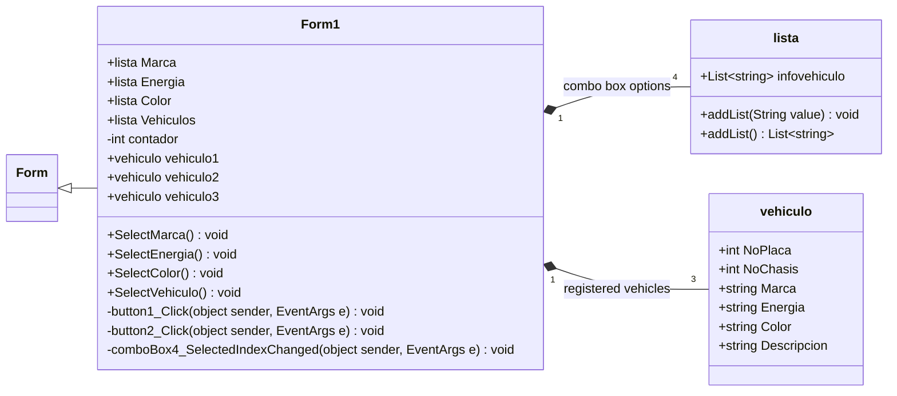

<div align="center">

# CSharp-OOP-Vehicle-Manager

**A Windows Forms application that registers vehicles as objects and displays their information on demand.**


</div>

---

## Table of Contents

- [About](#about)
- [At a Glance](#at-a-glance)
- [Features](#features)
- [Concepts Applied](#concepts-applied)
- [Class Diagram](#class-diagram)
- [Classes](#classes)
- [How to Run](#how-to-run)
- [Example Interaction](#example-interaction)
- [Project Structure](#project-structure)
- [Requirements](#requirements)
- [Tech Stack](#tech-stack)

---

## About

This project was developed for the **Programming 3** course of my **Systems Engineering** degree as preparation for an exam on object-oriented programming. It lets the user register vehicles through a form and later view the stored data of each one.

The project focuses on modeling data with classes, creating and filling objects, and binding collections to user interface controls.

> [!NOTE]
> The application's interface text is in Spanish. The UI texts and results in this document are shown translated into English.

---

## At a Glance

| | |
|---|---|
| **Type** | Windows Forms desktop application |
| **Target framework** | .NET Framework 4.7.2 |
| **Classes** | `Form1`, `lista`, `vehiculo` |
| **Difficulty** | ★★☆ |
| **Key concepts** | Classes and objects, composition, method overloading, `List<string>` |

---

## Features

- **Vehicle registration:** plate number, chassis number, brand, energy type, color and description.
- **Drop-down options:** brand (Toyota, Honda, Kia), energy type (Gasoline, Electric) and color (Blue, Red, Yellow), loaded from `lista` objects.
- **Three vehicle objects:** every click on **SAVE** fills the next `vehiculo` object (`vehiculo1`, `vehiculo2`, `vehiculo3`).
- **Information view:** selecting *Vehicle 1*, *2* or *3* in the *View information* combo box displays all of its data.
- **Reset:** the **RESET** button clears the input fields and returns the combo boxes to their initial option.

---

## Concepts Applied

- **Classes and objects:** `vehiculo` models a vehicle; `Form1` creates and fills three instances.
- **Composition:** `Form1` is built from `lista` and `vehiculo` objects.
- **Method overloading:** `lista` defines two `addList` methods: one adds an item, the other returns the list.
- **Generic collections:** `List<string>` stores the options of each combo box.
- **Data binding:** `ComboBox.DataSource` displays the content of each list.
- **`switch` statements:** select which vehicle to fill and which vehicle to display.
- **Event-driven programming:** `Click` handlers for SAVE and RESET, and `SelectedIndexChanged` for the information view.
- **Type conversion:** `Convert.ToInt32` for the plate and chassis numbers.

---

## Class Diagram

The only inheritance in the project is `Form1 : Form`. The `lista` and `vehiculo` classes are plain classes that `Form1` composes.



---

## Classes

<details>
<summary>Show class details</summary>

**`vehiculo`** (namespace `PreExamen.listas`): data class with public fields.

| Field | Type | Description |
|---|---|---|
| `NoPlaca` | `int` | Plate number |
| `NoChasis` | `int` | Chassis number |
| `Marca` | `string` | Brand |
| `Energia` | `string` | Energy type |
| `Color` | `string` | Color |
| `Descripcion` | `string` | Description |

**`lista`** (namespace `PreExamen.listas`): wrapper around a generic list.

| Member | Description |
|---|---|
| `List<string> infovehiculo` | Stores the items |
| `void addList(String value)` | Adds an item to the list |
| `List<string> addList()` | Returns the list (used as a `DataSource`) |

**`Form1`** (namespace `PreExamen`): the main form.

| Member | Description |
|---|---|
| `SelectMarca()`, `SelectEnergia()`, `SelectColor()`, `SelectVehiculo()` | Fill each `lista` and bind it to its combo box |
| `button1_Click` | SAVE: fills the next `vehiculo` object using a `switch` on `contador` |
| `button2_Click` | RESET: clears the inputs and resets the combo boxes |
| `comboBox4_SelectedIndexChanged` | Displays the data of the selected vehicle |

</details>

---

## How to Run

**Option 1: Visual Studio (recommended)**

Open `PreExamen.sln` in Visual Studio and press <kbd>F5</kbd>.

**Option 2: MSBuild**

From a *Developer Command Prompt for Visual Studio*:

```bash
cd CSharp-OOP-Vehicle-Manager
msbuild PreExamen.sln /p:Configuration=Debug
PreExamen\bin\Debug\PreExamen.exe
```

> [!NOTE]
> This is a .NET Framework 4.7.2 project, so it is built with Visual Studio or MSBuild rather than `dotnet run`.

---

## Example Interaction

<details>
<summary>Show an example registration</summary>

```text
ENTER VEHICLES
  Plate number:    123456
  Chassis number:  987654
  Brand:           Toyota
  Energy type:     Electric
  Color:           Blue
  Description:     Compact sedan
  [SAVE]                                 -> stored in Vehicle 1

VEHICLE INFORMATION
  View information: Vehicle 1

  The plate number is: 123456
  The chassis number is: 987654
  The brand is: Toyota
  The energy type is: Electric
  The color is: Blue
  The vehicle description is: Compact sedan
```

</details>

---

## Project Structure

```text
CSharp-OOP-Vehicle-Manager/
├── PreExamen.sln                # Visual Studio solution
└── PreExamen/
    ├── PreExamen.csproj         # Project file (.NET Framework 4.7.2)
    ├── Program.cs               # Application entry point
    ├── Form1.cs                 # Form logic and event handlers
    ├── Form1.Designer.cs        # Generated UI layout
    ├── Form1.resx               # Form resources
    ├── App.config               # Runtime configuration
    ├── listas/
    │   ├── lista.cs             # List wrapper class
    │   └── vehiculo.cs          # Vehicle data class
    └── Properties/              # Assembly info, resources and settings
```

---

## Requirements

- Windows
- Visual Studio 2019 or later with the *.NET desktop development* workload
- .NET Framework 4.7.2 Developer Pack (targeting pack)

Clone the repository:

```bash
git clone https://github.com/XanderiukS/CSharp-Fundamentals-University.git
```

---

## Tech Stack

| Category | Technology |
|---|---|
| Language | C# |
| Framework | .NET Framework 4.7.2 |
| UI | Windows Forms |
| IDE | Visual Studio |
| Version control | Git and GitHub |

---

<div align="center">

Part of [C# Fundamentals – University Projects](../README.md)

**Alexander Oliva** · [GitHub](https://github.com/XanderiukS) · [LinkedIn](https://www.linkedin.com/in/alexander-oliva-estrada)

</div>
