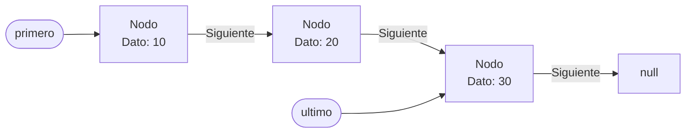
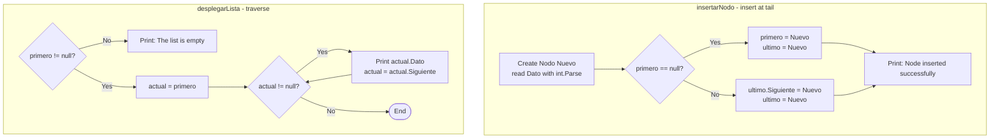
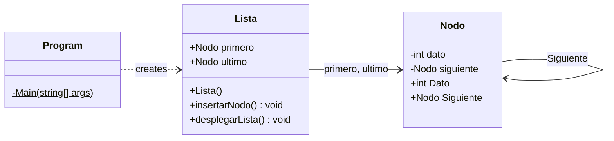

<div align="center">

# CSharp-Simple-Linked-Lists

**A console application that implements a singly linked list by hand, without using the built-in collections.**


</div>

---

## Table of Contents

- [About](#about)
- [At a Glance](#at-a-glance)
- [Concepts Applied](#concepts-applied)
- [List Structure](#list-structure)
- [Operations](#operations)
- [Classes](#classes)
- [How to Run](#how-to-run)
- [Sample Output](#sample-output)
- [Project Structure](#project-structure)
- [Requirements](#requirements)
- [Tech Stack](#tech-stack)

---

## About

This project was developed for the **Programming 3** course of my **Systems Engineering** degree. It builds a singly linked list from scratch: each node stores an integer and a reference to the next node, and the list keeps references to its first and last nodes.

When the program runs, `Main` asks for five integers, inserts each one at the end of the list and then prints the whole list. The source code keeps its original line-by-line comments from the learning process.

> [!NOTE]
> The program's console text is in Spanish. The sample output in this document is shown translated into English.

---

## At a Glance

| | |
|---|---|
| **Type** | Console application |
| **Target framework** | .NET Framework 4.7.2 |
| **Classes** | `Nodo`, `Lista`, `Program` |
| **Difficulty** | ★★☆ |
| **Key concepts** | Nodes and references, properties, tail insertion, traversal |

---

## Concepts Applied

- **Self-referencing class:** `Nodo` holds a reference to another `Nodo` through its `Siguiente` property.
- **Properties:** `Dato` and `Siguiente` encapsulate private fields with `get` and `set`.
- **Head and tail references:** `primero` and `ultimo` mark the start and end of the list.
- **Insertion at the tail:** a new node is linked after `ultimo`, or becomes the first node if the list is empty.
- **Traversal:** a `while` loop with a temporary reference (`actual`) moves from node to node until it reaches `null`.
- **Null checks and conditionals:** `if`/`else` to handle the empty list.
- **Console input and output:** `Console.ReadLine`, `int.Parse` and `Console.WriteLine`.

---

## List Structure



---

## Operations

The `Lista` class implements two operations: **insert at the tail** (`insertarNodo`) and **traverse** (`desplegarLista`).



---

## Classes

<details>
<summary>Show class details</summary>



| Class | Responsibility |
|---|---|
| `Nodo` | Stores one integer (`Dato`) and the reference to the next node (`Siguiente`) |
| `Lista` | Keeps the `primero` and `ultimo` references and implements `insertarNodo` and `desplegarLista` |
| `Program` | Entry point: creates a `Lista`, inserts five nodes and prints the list |

</details>

---

## How to Run

**Option 1: Visual Studio (recommended)**

Open `ListasSimplesConsola.sln` in Visual Studio and press <kbd>F5</kbd>.

**Option 2: MSBuild**

From a *Developer Command Prompt for Visual Studio*:

```bash
cd CSharp-Simple-Linked-Lists
msbuild ListasSimplesConsola.sln /p:Configuration=Debug
ListasSimplesConsola\bin\Debug\ListasSimplesConsola.exe
```

> [!NOTE]
> This is a .NET Framework 4.7.2 project, so it is built with Visual Studio or MSBuild rather than `dotnet run`.

---

## Sample Output

<details>
<summary>Show a full run with the values 10, 20, 30, 40 and 50</summary>

```text
Enter the data for the new NODE
10

 Node inserted successfully

Enter the data for the new NODE
20

 Node inserted successfully

Enter the data for the new NODE
30

 Node inserted successfully

Enter the data for the new NODE
40

 Node inserted successfully

Enter the data for the new NODE
50

 Node inserted successfully

10
20
30
40
50
```

</details>

---

## Project Structure

```text
CSharp-Simple-Linked-Lists/
├── ListasSimplesConsola.sln           # Visual Studio solution
└── ListasSimplesConsola/
    ├── ListasSimplesConsola.csproj    # Project file (.NET Framework 4.7.2, console)
    ├── Program.cs                     # Entry point: inserts five nodes and prints the list
    ├── Nodo.cs                        # Node class (Dato, Siguiente)
    ├── Lista.cs                       # Linked list class (insertarNodo, desplegarLista)
    ├── App.config                     # Runtime configuration
    └── Properties/
        └── AssemblyInfo.cs            # Assembly information
```

---

## Requirements

- Windows
- Visual Studio 2019 or later with the *.NET desktop development* workload
- .NET Framework 4.7.2 Developer Pack (targeting pack)

Clone the repository:

```bash
git clone https://github.com/XanderiukS/CSharp-Fundamentals-University.git
```

---

## Tech Stack

| Category | Technology |
|---|---|
| Language | C# |
| Framework | .NET Framework 4.7.2 |
| Application type | Console |
| IDE | Visual Studio |
| Version control | Git and GitHub |

---

<div align="center">

Part of [C# Fundamentals – University Projects](../README.md)

**Alexander Oliva** · [GitHub](https://github.com/XanderiukS) · [LinkedIn](https://www.linkedin.com/in/alexander-oliva-estrada)

</div>
