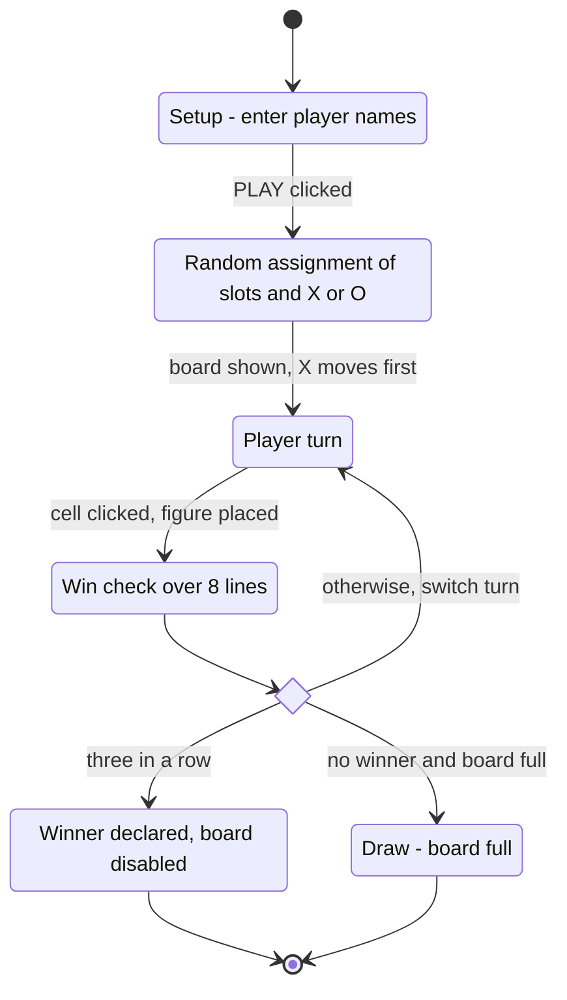

<div align="center">

# CSharp-TicTacToe-Project

**A two-player tic-tac-toe game built with Windows Forms, with random figure assignment and win or draw detection.**


</div>

---

## Table of Contents

- [About](#about)
- [At a Glance](#at-a-glance)
- [How the Game Works](#how-the-game-works)
- [Concepts Applied](#concepts-applied)
- [Game Flow](#game-flow)
- [Main Methods](#main-methods)
- [How to Run](#how-to-run)
- [Example Game](#example-game)
- [Project Structure](#project-structure)
- [Requirements](#requirements)
- [Tech Stack](#tech-stack)

---

## About

This project was developed for the **Programming 3** course of my **Systems Engineering** degree. It is a digital version of tic-tac-toe (*totito*) for two players on the same computer.

The project brings together event-driven programming, game logic and the dynamic manipulation of user interface controls at runtime.

> [!NOTE]
> The application's interface text is in Spanish. The UI texts and messages in this document are shown translated into English.

---

## At a Glance

| | |
|---|---|
| **Type** | Windows Forms desktop application |
| **Target framework** | .NET Framework 4.7.2 |
| **Main class** | `Form1` (namespace `totito`) |
| **Difficulty** | ★★★ |
| **Key concepts** | Event-driven programming, boolean methods, `Random`, dynamic UI |

---

## How the Game Works

1. Both players enter their names and press **PLAY**.
2. The game uses `Random` to place the players in the *Player 1* / *Player 2* slots and to assign the **X** and **O** figures. The player holding **X** moves first.
3. The registration panel is hidden and the 3×3 board is shown, together with each player's assigned figure and the current turn.
4. On each click, the current figure is written on the cell and the cell is disabled.
5. After every move the game checks the 8 winning lines (3 rows, 3 columns and 2 diagonals):
   - **Win:** the winner's name is displayed, a congratulations message appears and the board is disabled.
   - **Draw:** if the board is full with no winner, a draw message appears.
   - Otherwise, the turn passes to the other player.

---

## Concepts Applied

- **Event-driven programming:** a `Click` handler for the PLAY button and one for each of the nine board cells.
- **The `Random` class:** `Random.Next(2)` to assign the player slots and the figures.
- **Boolean helper methods:** `MismaFigura`, `ganador` and `TableroLleno` return `bool` to drive the game decisions.
- **Game logic:** evaluation of the 8 winning lines by comparing three buttons at a time.
- **Dynamic UI:** runtime changes to the `Visible`, `Enabled`, `Text` and `Font` properties of the controls.
- **User feedback:** `MessageBox.Show` to announce the winner or a draw.

---

## Game Flow



---

## Main Methods

| Method | Returns | Purpose |
|---|---|---|
| `Juego()` | `void` | Assigns slots and figures at random and shows the board |
| `turno(int)` | `void` | Marks whose turn it is |
| `cambioTurno()` | `void` | Passes the turn to the other player |
| `MismaFigura(Button, Button, Button)` | `bool` | Checks whether three cells contain the same figure |
| `ganador()` | `bool` | Evaluates the 8 winning lines |
| `TableroLleno()` | `bool` | Checks whether every cell has been played |
| `DesactivarTablero()` | `void` | Disables the board when the game ends |

---

## How to Run

**Option 1: Visual Studio (recommended)**

Open `totito.sln` in Visual Studio and press <kbd>F5</kbd>.

**Option 2: MSBuild**

From a *Developer Command Prompt for Visual Studio*:

```bash
cd CSharp-TicTacToe-Project
msbuild totito.sln /p:Configuration=Debug
totito\bin\Debug\totito.exe
```

> [!NOTE]
> This is a .NET Framework 4.7.2 project, so it is built with Visual Studio or MSBuild rather than `dotnet run`.

---

## Example Game

<details>
<summary>Show an example game</summary>

```text
Player 1 name: Ana
Player 2 name: Luis
[PLAY]

Assigned figures:  Ana -> X    Luis -> O
Current turn: X

 X | O | X
---+---+---
   | X | O
---+---+---
 O |   | X

Status:  Winner: Ana!
Message: "Congratulations Ana!"            (title: Game Over)
```

If the nine cells are filled without three in a row:

```text
Status:  It's a draw!
Message: "The board is full. Nobody wins!" (title: Draw)
```

</details>

---

## Project Structure

```text
CSharp-TicTacToe-Project/
├── totito.sln                   # Visual Studio solution
└── totito/
    ├── totito.csproj            # Project file (.NET Framework 4.7.2)
    ├── Program.cs               # Application entry point
    ├── Form1.cs                 # Game logic and event handlers
    ├── Form1.Designer.cs        # Generated UI layout (panels and 3x3 board)
    ├── Form1.resx               # Form resources
    ├── App.config               # Runtime configuration
    └── Properties/              # Assembly info, resources and settings
```

---

## Requirements

- Windows
- Visual Studio 2019 or later with the *.NET desktop development* workload
- .NET Framework 4.7.2 Developer Pack (targeting pack)

Clone the repository:

```bash
git clone https://github.com/XanderiukS/CSharp-Fundamentals-University.git
```

---

## Tech Stack

| Category | Technology |
|---|---|
| Language | C# |
| Framework | .NET Framework 4.7.2 |
| UI | Windows Forms |
| IDE | Visual Studio |
| Version control | Git and GitHub |

---

<div align="center">

Part of [C# Fundamentals – University Projects](../README.md)

**Alexander Oliva** · [GitHub](https://github.com/XanderiukS) · [LinkedIn](https://www.linkedin.com/in/alexander-oliva-estrada)

</div>
